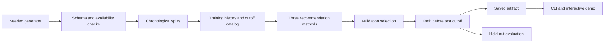

# Technical report: product recommendations

## Objective and prediction contract

For each shopper at a fixed cutoff, recommend ten available, previously unexplored products. A relevant target is a product with a cart or purchase in the following 30 days. Views are weak history signals but not positive evaluation labels. All previously interacted products are excluded, including prior views. This defines discovery; replenishment and repeat purchases are outside scope.

Outputs include rank, product, score, reason and contributing historical product where available. Scores are ranking signals, not calibrated purchase probabilities. No sensitive attributes or high-stakes decisions are involved.

## Architecture

## Data and exploratory analysis

Seed 42 produces 20,982 events, 300 shoppers and 360 products. Event counts: 13,260 views, 4,255 carts and 3,467 purchases. Observed shopper-product pairs occupy 14.00% of the matrix. Required values are complete and event IDs unique. Synthetic prices range from 15.92 to 219.82, with median 123.10. The demo plots daily activity and category frequencies; underlying values are in `reports/eda.json`, `daily_events.csv` and `category_events.csv`.

The matrix is sparse and popularity is uneven. Newly introduced users/products create cold-start segments. Full-data EDA is descriptive; it does not fit features or influence selection. Product category, style and brand are content features. Price is displayed but is not a model feature. Weights are fixed before evaluation: view=1, cart=3, purchase=5. See the data card for provenance and quality handling.

## Models

1. Popularity ranks by distinct prior shoppers interacting with a product.
2. Content fits TF-IDF to available product category/style/brand, then computes cosine similarity. Candidate scores average similarities to historical products weighted by `log(1 + summed event weights)`.
3. Collaborative filtering uses a sparse shopper-item matrix with the same log weights. Item-item cosine similarity captures co-engagement. The score averages similarity to historical products using those weights.

Self-similarity is removed from collaborative scores, and all seen items are excluded. Ties use prior popularity then product ID. Unknown users use popularity. Zero-signal candidates are ranked by popularity below positive-signal candidates. Reasons identify the highest contributing historical product and, for content, shared attributes. These explain signals, not causality.

## Split strategy and leakage prevention

| Split | Interval in 2025 | Events |
|---|---|---:|
| Train | Jan 1 inclusive to May 1 exclusive | 13,284 |
| Validation | May 1 inclusive to May 31 exclusive | 3,526 |
| Test | May 31 inclusive to June 30 exclusive | 4,172 |

Validation uses only history before May 1. Validation NDCG@10 is 0.0721 popularity, 0.0685 content, 0.1120 collaborative. Collaborative is selected before test evaluation. All models are then refitted using history before May 31, with the final 30 days held out. There is no hyperparameter search; test comparisons do not change the selection.

Catalog, TF-IDF vocabulary/IDF, popularity, profiles and similarities respect the prediction cutoff. Products launching exactly at a cutoff can be recommended with no history. Later products would be excluded and counted in the audit. Tests verify future interactions and future product metadata cannot change fitted predictions/features.

## Evaluation and denominators

Evaluate the complete available catalog after excluding seen items; no sampled negatives. Relevant products are deduplicated. Precision@10 = hits/10. Recall@10 = hits/eligible targets. NDCG@10 discounts hits by logarithmic rank and normalizes by ideal ranking. Metrics are macro averages over users with eligible targets. Coverage is distinct recommended products divided by catalog size. Cold-item recall is micro recall over targets with zero prior interactions.

Test contains 1,557 positive events. Of these, 519 concern seen products and are excluded; none concern unavailable products. Of 285 users with positive events, 274 have eligible targets and 11 have none. Evaluated users: 243 warm and 31 cold. Users without future positives are excluded, so results are conditional on future engagement. Cold users may include a previously introduced user without any prior events.

## Held-out results

| Method | Precision@10 | Recall@10 | NDCG@10 | Coverage | Cold-item recall |
|---|---:|---:|---:|---:|---:|
| Popularity | 0.0274 | 0.0791 | 0.0550 | 11.11% | 0.00% |
| Content | 0.0416 | 0.1151 | 0.0836 | 98.61% | 18.07% |
| Collaborative | 0.0427 | 0.1195 | 0.0894 | 38.06% | 0.00% |

Collaborative finds about 0.427 relevant products per ten recommendations. Its NDCG is about 62.6% above popularity relatively, but absolute quality remains modest. Warm-user NDCG is 0.0458 / 0.0781 / 0.0847. All methods have identical cold-user NDCG 0.1270 due to shared fallback. Content finds 15 of 83 cold-item targets; collaborative finds none. This reveals the tradeoff between ranking quality and new-product reach.

Results are descriptive single-seed simulation results, without confidence intervals or a significance claim. The generator favors learnable category/style structure. Broad content coverage alone does not demonstrate user satisfaction.

## Error analysis and explainability

`reports/error_cases.json` contains selected-method examples. U0139 has NDCG 0.6714 and three eligible targets; U0000 has four targets and no top-ten hits. U0000's first recommendation P0055 has its strongest contribution from historical product P0114. The co-engagement signal is supported by training data but fails to predict this user's future targets. A faithful explanation does not guarantee correctness.

Errors can arise from stochastic behavior, sparse history, unmodeled budget preferences, changing tastes and poor co-engagement estimates. No observed interaction does not imply dislike. Similar attributes may fail to discriminate products. A hybrid is a potential extension, but must be selected through a new validation experiment without using these test results for tuning.

## Limitations and responsible use

No real personal data is used. Popularity fallback concentrates exposure, so coverage and cold-start behavior are reported. Real data needs rights verification, privacy controls and representativeness checks. The app is a local demo without authentication, stock updates or online learning. Catalog updates require retraining. Dense item similarities require quadratic memory and would need a retrieval redesign for a large catalog. The synthetic simulation omits exposure/selection bias, promotions, returns and many real behaviors.

## Reproducibility and tests

README commands regenerate datasets, splits, models and reports. The manifest records versions, seed, cutoffs and hashes. Tests cover repeatability, invalid schemas, future-data isolation, unseen/unique recommendations, cold users/items, hand-calculated metrics, artifact round trips, JSON responses and interactive shopper/method changes. CI generates the artifact before running tests. Only trusted locally generated pickle artifacts should be loaded.

## Attribution and references

NumPy supplies seeded randomness and numerical operations; pandas provides data preparation; SciPy supplies sparse matrices; scikit-learn supplies [TF-IDF](https://scikit-learn.org/stable/modules/generated/sklearn.feature_extraction.text.TfidfVectorizer.html) and cosine similarity; Streamlit provides the interface and [resource caching](https://docs.streamlit.io/develop/api-reference/caching-and-state/st.cache_resource); pytest provides tests. Exact direct versions are in requirements.txt. OpenAI Codex assisted with design, implementation, tests and documentation. No external customer dataset is used.
